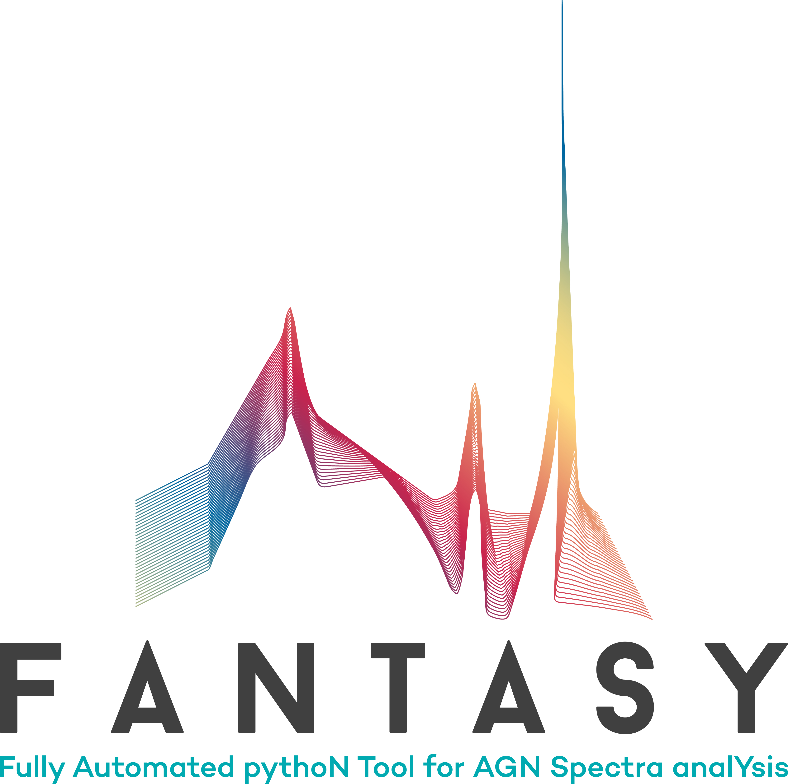

# FANTASY: Fully Automated pythoN tool for AGN Spectra analYsis

*Nemanja Rakić, Dragana Ilić and Luka Č. Popović*

FANTASY fits AGN spectra with many components at once: power-law continuum, Balmer
continuum, FeII templates, host galaxy, and any number of narrow, broad and outflow
line components with tied kinematics and fixed line ratios. It works in the optical
(3600–8000 Å), UV (1400–3600 Å) and NIR (8000–11000 Å) rest frame.

Version 2 is a rewrite with these features:

- **Fast.** Exact analytic derivatives and a pure NumPy/SciPy engine. An Hβ-region fit
  of an SDSS quasar with FeII and two broad components takes about 1.5 s.
- **Robust starting values.** The initial guess solves every amplitude exactly
  (bounded linear least squares) and grid-searches widths and shifts within your
  limits, so the result does not depend on the values you start from.
- **Reliable uncertainties.** You can choose covariance errors (fast) or Monte Carlo
  errors (slower, better for weak or blended lines), and errors are propagated to
  derived quantities: total broad-line flux, FWHM, line dispersion, EW, luminosity and
  black-hole mass. Simulations show the errors are calibrated (see `tests/`).
- **Ready-made models** for Hβ, Hα, the full optical range, MgII and CIV.
- **Joint multi-epoch fitting.** Narrow lines are shared across epochs and calibrate
  the flux scale, for reverberation-mapping light curves.
- **Point-and-click GUI** in Jupyter for beginners.
- **Easy to install.** It needs only numpy, scipy, astropy, pandas and matplotlib.

## Installation

**Testers and new users**: unzip `FANTASY-2.0.0.zip` (built with `sh install/make_bundle.sh`)
and run the installer:

| system | install |
|---|---|
| macOS | double-click `Install FANTASY.command` |
| Linux | `sh install.sh` |
| Windows | double-click `install.bat` |

The installer uses [uv](https://docs.astral.sh/uv/) (and offers to install it). It installs
FANTASY with Python 3.12 and the tested package versions in an environment of its own, adds
the `fantasy` command, and runs the self-test. Then:

```console
fantasy app              # the FANTASY app in the browser
fantasy test [--full]    # check the installation (--full: templates and online services)
fantasy info             # versions, processor cores, templates
fantasy examples DIR     # example spectra and a first script
fantasy python           # Python with FANTASY installed
```

Without the bundle, uv can install it from a wheel or from git:

```console
uv tool install --python 3.12 fantasy_agn-2.0.0-py3-none-any.whl
uv tool install --python 3.12 "git+https://github.com/yukawa1/fantasy@v2"
```

**From a clone of the repository**, the launchers start the app directly with the locked
versions (`uv.lock`):

| system | start the app |
|---|---|
| macOS | double-click `launch/FANTASY.command` (or run `launch/fantasy-app.sh`) |
| Linux | `launch/fantasy-app.sh` |
| Windows | double-click `launch\fantasy-app.bat` |

As a Python package in your own environment:

```console
pip install fantasy_agn-2.0.0-py3-none-any.whl   # then: fantasy test
```

## Quick start

```python
import fantasy_agn as fa

spec = fa.read("spec-1059-52618-0453.fits")          # SDSS, DESI, OzDES, GAMA, 1D FITS or text
spec = spec.deredden().to_rest_frame()   # Galactic E(B-V) looked up; z from the file

result = fa.fit(spec, fa.presets.hbeta())
result.plot()
result.lines                 # flux, FWHM, shift, EW of every line, with errors
result.measure("Hb", ["broad", "broad2"])   # broad Hβ: flux, FWHM, sigma, shift, EW
                             # (without components: summed over all, narrow included)
result.bh_mass()             # single-epoch virial mass (Vestergaard & Peterson 2006)
result.save("my_quasar")     # CSV tables + model spectrum
fa.save(result, "my_quasar.fantasy")     # the whole result, to reopen later:
result = fa.load("my_quasar.fantasy")    # plot, measure, refit ... as before
```

For Monte Carlo errors use `fa.fit(spec, model, errors="mc", n_mc=100)`.

### Figures for papers

Plots use a journal style (serif STIX fonts, inward ticks, colour-blind-safe colours,
physical units on the axes) and are saved with embedded fonts:

```python
result.savefig("fit.pdf")                                  # or .eps, .svg, .png (300 dpi)
result.savefig("hb.eps", width="single", xlim=(4600, 5150)) # one journal column, zoomed
result.savefig("fit.pdf", label_lines=True)                 # annotate the strongest lines
result.savefig("fit.pdf", group=False)                      # every component separately
res.plot_light_curves(save="light_curves.pdf")              # multi-epoch light curves
```

When a line is fitted with several components (two broad components, an outflow wing), the
figure shows each of them (1st broad component dashed, 2nd dotted) besides their sum. One line
alone, with all its components on a velocity axis and the rest of the model subtracted:

```python
result.fitted_lines()                     # the lines you can show, multi-component ones first
result.plot_line()                        # the main line (broad Hβ, Hα, MgII, CIV; [OIII] for type 2)
result.plot_line("Ha", others=True)       # Hα, with the neighbouring [NII] lines dotted
result.plot_lines(["Hb", "[OIII]5007", "Ha"])   # side by side
```

`result.plot(...)` takes the same options and returns the matplotlib figure for
further editing. The GUI offers the figure as PDF, EPS and PNG downloads.

### DESI spectra

```python
fa.desi.targets("coadd-main-dark-10032.fits", redrock="redrock-main-dark-10032.fits")
spec = fa.read("coadd-main-dark-10032.fits", targetid=39627640566453451,
               redrock="redrock-main-dark-10032.fits").to_rest_frame()
quasars = fa.desi.read_all("coadd-main-dark-10032.fits", redrock="redrock-main-dark-10032.fits",
                           spectype="QSO", zmax=0.8)
spec = fa.desi.from_sparcl(record)   # a record retrieved with NOIRLab's SPARCL client
```

DESI coadd files hold many targets; the B, R and Z arms are merged with inverse-variance
weights in their overlaps, masked pixels are skipped, and the instrumental resolution is
taken from each target's resolution matrix. Because it changes by about a factor of two
from blue to red, every line is corrected with the resolution at its own wavelength.

### OzDES spectra

```python
path = fa.ozdes.download("SVA1_COADD-2937976373", "ozdes/")[0]   # original DR2 file (VizieR)
spec = fa.read(path)                     # the stack; fa.read(path, epoch=4): one exposure
nights = fa.ozdes.read_epochs(path, skip_qc=True, combine="night")
me = fa.fit_epochs([n.deredden().to_rest_frame() for n in nights], fa.presets.hbeta(outflow=True),
                   shared=("narrow.*", "outflow.*", "feii.fwhm", "feii.shift"))
```

OzDES DR2 files (2dF/AAOmega, R ≈ 1400) hold the stack and every exposure with variance and
bad-pixel mask. They are **not flux calibrated** (counts, not even relatively between nights),
so luminosities and black-hole masses are not computed; widths, shifts, EWs, line ratios and
intercalibrated light curves are. `combine="night"` averages the (usually three) exposures of
each night. Flux-only spectra from the Data Central SSA service are read too
(`fa.ozdes.search`, `download(..., source="ssa")`); their noise is estimated from the data.

### Ready-made models

| preset | range [Å] | components |
|---|---|---|
| `fa.presets.hbeta()` | 4150–5550 | power law, FeII (shift tied to broad Hβ), narrow Hγ/[OIII]4363/Hβ/[OIII]4959,5007, [OIII] outflow wing, broad Hγ+Hβ (1, 2, 3 … components), broad HeII |
| `fa.presets.halpha()` | 6200–6900 | power law, narrow [OI], [NII], Hα, [SII], broad Hα (1, 2, 3 … components) |
| `fa.presets.optical()` | 3700–6900 | broken power law, high-order Balmer lines, and all of the above plus [OII], [NeIII], Hδ, HeI; `host=True` for host-dominated quasars |
| `fa.presets.mgii()` | 2650–3050 | power law, Balmer continuum, UV FeII, broad MgII (`narrow=True` adds narrow MgII) |
| `fa.presets.civ()` | 1450–1720 | power law, broad CIV (2 components), HeII1640, OIII]1663; use `spec.mask_absorption()` first |

The defaults (outflow wings, numbers of broad components, ties) were calibrated on 1500 SDSS spectra (`calibration/`).
Options include `broad_components=1, 2, 3, …` (compare `result.bic` to choose), `outflow=False` (no [OIII] wing),
`host=True` (host galaxy fitted together with the AGN) and `feii=False`.
`fa.presets.available(spec)` lists the presets your spectrum covers.

### Your own model

```python
model = fa.Model(
    fa.PowerLaw(pivot=5100),
    fa.FeII(fwhm=(2000, 1000, 6000)),
    fa.Lines("narrow", ["Hb", "[OIII]4959", "[OIII]5007"], fwhm=(400, 100, 1200),
             ratios={"[OIII]4959": ("[OIII]5007", 1 / 2.98)}),
    fa.Lines("broad", ["Hg", "Hb"], fwhm=(4000, 1000, 15000)),   # shared kinematics
    wave_range=(4200, 5500),
)
model.set("broad.shift", min=-1000, max=1000)   # change limits
model.fix("feii.shift", 0)                      # fix a parameter
model.tie("feii.fwhm", "broad.fwhm")            # tie: feii.fwhm = broad.fwhm
model.tie("narrow.Hb.flux", "narrow.[OIII]5007.flux", factor=0.1)   # fixed ratio
result = fa.fit(spec, model)
```

Lines are given by name from the built-in list (`fa.LINES`) or as
`(name, vacuum wavelength)` pairs. Every line group has its own velocity shift and
FWHM in km/s. The instrumental resolution is removed automatically; for SDSS it is
read from the file.

### Host galaxy, line shapes, reddening

```python
fa.templates.download("emiles")        # once: E-MILES stellar populations, 13 MB

model = fa.presets.hbeta(host=True)    # non-negative stellar templates, fits sigma* and v*
result = fa.fit(spec, model)
result.host_properties()               # sigma*, v*, host fraction, age, [M/H] with errors

fa.presets.hbeta(broad_profile="gauss-hermite")   # or "lorentzian", "voigt"
fa.presets.optical(extinction=True)               # intrinsic E(B-V); fluxes dereddened
```

The stellar host cannot become negative (unlike the PCA eigenspectra of version 1,
still available as `host="pca"`). Its velocity dispersion is reliable down to the
resolution limit of the templates (about 40–50 km/s for E-MILES on SDSS spectra),
which `host_properties()` reports. If no stellar absorption features are detected,
it warns that the "host" only describes a continuum shape. The templates are
the files that pPXF distributes; please cite Vazdekis et al. (2016) when you use them.

### How much does the answer depend on the model?

Broad-line widths depend on the decomposition (number of broad components, outflow
wings) much more than on the noise. `fa.compare` fits several variants and adds a
systematic error from the spread over the acceptable ones:

```python
cmp = fa.compare(spec, fa.presets.variants("hbeta"))   # 1-3 broad components, +/- outflow
cmp.table        # chi2, reduced chi2, BIC and the quantities for every model
cmp.summary()    # best-model value, statistical, systematic and total error
```

Models with several overlapping components are also fitted by adding them one at a time,
which avoids local minima; the better of the two solutions is kept (`result.start`).

### Bayesian errors

```python
result = fa.fit(spec, model, errors="mcmc")   # Hamiltonian Monte Carlo, built in
result.mcmc_info                              # acceptance, R-hat, effective samples
```

Hamiltonian Monte Carlo uses the exact gradient and the fit covariance as a
preconditioner, so it needs no extra packages and samples a 30-parameter Hβ model in
about a minute.

### Several epochs

```python
spectra = [fa.read(f).to_rest_frame() for f in files]
res = fa.fit_epochs(spectra, fa.presets.hbeta(), shared=["narrow.*"])
res.scales           # flux intercalibration factors
res.light_curve()    # broad-line fluxes, FWHMs and continuum per epoch, with errors
res.plot_light_curves()
```

### The app (no programming needed)

```console
fantasy-app          # or a launcher in launch/, or fa.app() from Python
```

The app opens in your browser and runs only on your computer. Follow the steps
**read → classify → fit → results**: drop a spectrum (or give a path or a DESI
TARGETID), let `classify()` decide what kind of object it is, and fit the recommended
model. Every button writes ordinary FANTASY code into the code panel and runs it; you
can **edit any cell and run it again** (Shift+Enter) or add your own cells, all in one
namespace (`spec`, `c`, `model`, `r`). Download the figure (PDF/EPS/PNG), the line
table, or the whole session as a Python script.

## Upgrading from 1.x

Version 2 no longer uses Sherpa. See [CHANGELOG.md](CHANGELOG.md) for how to move
1.x scripts over. The 1.x tutorials are in the 1.x releases (`pip install "fantasy_agn<2"`).

## Citation

If you use FANTASY in your research, please cite
[Ilić et al. (2020)](https://ui.adsabs.harvard.edu/abs/2020A%26A...638A..13I/abstract),
[Rakić (2022)](https://ui.adsabs.harvard.edu/abs/2022MNRAS.516.1624R/abstract) and
[Ilić, Rakić & Popović (2023)](https://ui.adsabs.harvard.edu/abs/2023ApJS..267...19I/abstract).

Documentation: <https://fantasy-agn.readthedocs.io>
